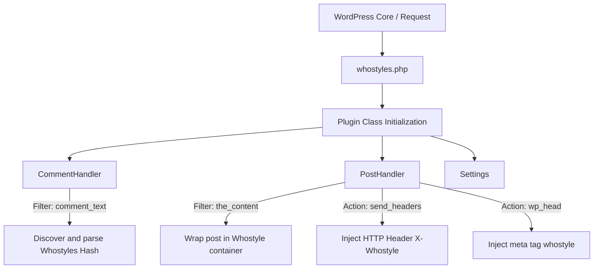

# Architecture

This document describes the architectural design and implementation details of the Whostyles WordPress plugin.

---

## 1. Overview
The Whostyles WordPress plugin integrates the Whostyles V1 (Hash Protocol) with WordPress.
It allows WordPress sites to automatically process, render, and syndicates personal typographic and cosmetic
styles for posts and user comments without compromising security or layout integrity.

---

## 2. Component Design

The plugin uses the namespace `Whostyles\WordPress`. The execution flow is centered around a main bootstrap class,
and handlers that target specific hook layers in WordPress.

### A. Core Bootstrap (`Plugin.php`)
* **Role**: Orchestrates the instantiation and registration of all handlers.
* **Initialization**: Instantiated during the `plugins_loaded` action.
* **Autoloading**: Relies on Composer’s PSR-4 autoloader.

### B. Comment Handler (`CommentHandler.php`)
* **Role**: Listens to comment content filters and parses them for Whostyle hashes.
* **Hook**: Intercepts `comment_text`.
* **Execution Flow**:
  1. Receives comment content.
  2. Runs `Whostyles::discover($content)` to identify hashes.
  3. If a hash is found:
     - Generates the CSS container wrapper classes and styles.
     - Wraps the comment content in a `div` element with class `whostyle-container ws-rendered`.
     - Cleans the raw inline `{ws1:...}` text from the comment to ensure a clean UI.
  4. Returns the wrapped and cleaned comment content.

### C. Post Handler (`PostHandler.php`)
* **Role**: Configures Whostyle settings on posts and handles metadata output.
* **Metadata**: Stores post-specific hashes using the custom field `_whostyle_hash`.
* **Hooks**:
  - `send_headers`: Sends the `X-Whostyle: {ws1:...}` HTTP header if a post hash is defined.
  - `wp_head`: Injects `<meta name="whostyle" content="{ws1:...}">` for standard crawler discovery.
  - `the_content`: Envelops the post body inside a `.whostyle-container` to apply the visual theme.
  - `wp_enqueue_scripts`: Enqueues the styling assets.

### D. Settings Handler (`Settings.php`)
* **Role**: Handles admin settings for enabling or disabling Whostyles globally or per context.
* **Settings Page**: Accessible under Settings -> Whostyles.

---

## 3. Security Considerations
* **Strict Attribute Injection**: The plugin only uses CSS Custom Properties (variables) generated by the
  `Whostyles\Whostyles` decoder. No raw, unescaped CSS properties are injected into inline styles.
* **WordPress Sanitization**: All outputs (classes, inline style attributes) are escaped before printing
  using `esc_attr()`.
* **Layout Safeguards**: The `.whostyle-container` rule enforces text wrapping boundaries and rejects
  unauthorized layout overrides (such as `position: fixed`, `width: 100vw`, etc.).
